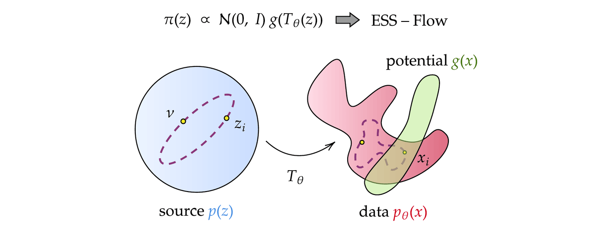
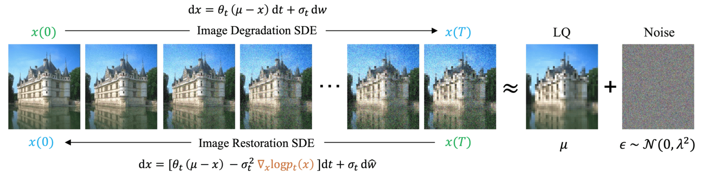
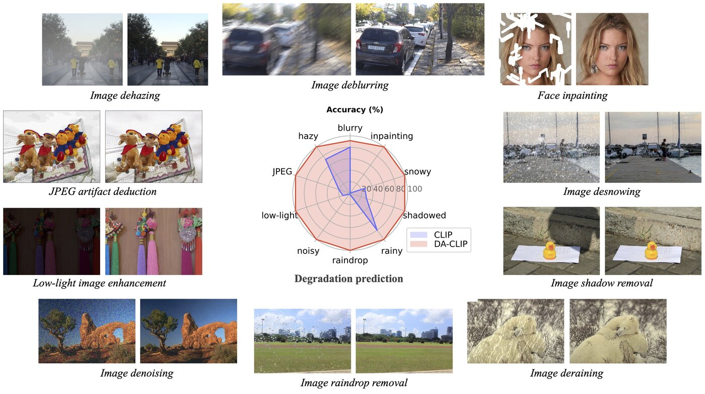
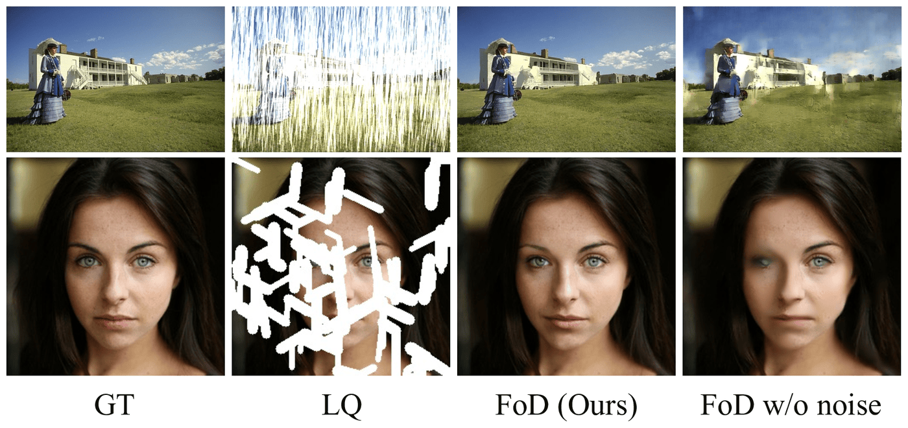

Generative models and Bayesian inference are key tools for accelerating scientific discovery by enabling efficient exploration of large design spaces. We work on both foundational aspects of these models and their application to scientific and engineering problems.

## Training-free conditional inference

A key challenge for incorporating pretrained generative models into Bayesian experimental design loops is performing conditional inference without costly retraining. We develop methods that condition pretrained diffusion and flow-based models on observations or target properties at inference time.

A flow-based model maps samples from a source distribution, typically Gaussian, to data. ESS-Flow uses this structure to perform Bayesian inference directly in the source space with elliptical slice sampling. It needs only forward passes through the generative model and the observation process, so it also applies when gradients are unreliable or unavailable, for example with simulation-based observations.

<small>ESS-Flow performs conditional inference by applying a potential function in the source space of a flow model, avoiding costly retraining.</small>

For diffusion models, we express exact conditional simulation within the unconditional model as inference over a partial bridge of the denoising stochastic differential equation. Particle Gibbs and pseudo-marginal samplers then target the conditional distribution without any approximation beyond the Monte Carlo error.

Guidance-based methods steer a pretrained model toward a reward or an observation and only approximate the resulting target distribution. Sequential Monte Carlo corrects for this with importance weights, but in practice the weights degenerate and the particles collapse onto a few samples. Interacting particle guidance replaces the reweighting with an additional drift, derived from the Feynman–Kac equation, that moves the particles instead. With the drift chosen in a reproducing kernel Hilbert space, it has a closed form and costs little more than sequential Monte Carlo.

- Kalaivanan A, Zhao Z, **Sjölund J**, and Lindsten F. [_ESS-Flow: Training-free guidance of flow-based models as inference in source space._](https://arxiv.org/abs/2510.05849) NeurIPS (2026).
- Corenflos A, Zhao Z, Särkkä S, **Sjölund J**, and Schön T B. [_Conditioning diffusion models by explicit forward-backward bridging._](https://arxiv.org/abs/2405.13794) AISTATS (2025).
- Kalaivanan A, Zhao Z, **Sjölund J**, and Lindsten F. [_Interacting particle guidance for sampling reward-tilted generative priors._](https://arxiv.org/abs/2609.37227) arXiv (2026).

## Image restoration with mean-reverting SDEs

Our work on diffusion models for image restoration introduced a mean-reverting stochastic differential equation (SDE) that transforms a high-quality image into a degraded counterpart as a mean state with fixed Gaussian noise. By simulating the corresponding reverse-time SDE, we restore the original image without relying on any task-specific prior knowledge. This approach has a closed-form solution, allowing exact computation of the time-dependent score. The method achieves highly competitive performance on deraining, deblurring, denoising, super-resolution, inpainting, and dehazing, and has been widely adopted since its publication at ICML 2023.

<small>The forward SDE degrades a clean image towards a noisy low-quality mean; the learned reverse-time SDE restores it.</small>

<video autoplay loop muted playsinline width="60%" style="border-radius: 4px;">
  <source src="https://algolzw.github.io/ir-sde/images/derain.mp4" type="video/mp4">
  <source src="/assets/video/derain.mp4" type="video/mp4">
</video>

<small>IR-SDE progressively removes rain streaks via the reverse-time SDE.</small>

In a follow-up, we showed how vision-language models can be steered for universal image restoration across ten different degradation types, using degradation-aware CLIP embeddings to guide the restoration process.

<small>DA-CLIP handles ten different image degradation types with a single model, using degradation-aware CLIP embeddings.</small>

More recently, we have removed the coupled forward-backward pair altogether. Making the mean-reverting term state-dependent, so that it appears in both the drift and the diffusion function, lets a single forward process interpolate between the low-quality and the clean distribution. The resulting model, _state-dependent forward diffusion_ (FoD), is analytically tractable and is trained with a stochastic flow matching objective, so sampling takes only a few steps. Setting the diffusion term to zero reduces FoD to deterministic flow matching, and the restored images then come out over-smoothed, so it is the stochasticity that recovers the high-frequency detail.

<small>Removing the stochastic diffusion term (right) reduces FoD to deterministic flow matching, which over-smooths and leaves artifacts in heavily degraded regions.</small>

- Luo Z, Gustafsson F K, Zhao Z, **Sjölund J**, and Schön T B. [_Image restoration with mean-reverting stochastic differential equations._](https://proceedings.mlr.press/v202/luo23b.html) ICML (2023).
- Luo Z, Gustafsson F K, Zhao Z, **Sjölund J**, and Schön T B. [_Controlling vision-language models for universal image restoration._](https://arxiv.org/abs/2310.01018) ICLR (2024).
- Luo Z, Gustafsson F K, **Sjölund J**, and Schön T B. [_Efficient image restoration with state-dependent forward diffusion._](https://openreview.net/forum?id=Eq9k6Va3hY) Transactions on Machine Learning Research (2026).

## Reviews and broader contributions

We have contributed two authoritative reviews to Philosophical Transactions of the Royal Society A, covering conditional sampling within generative diffusion models and the state of the art in diffusion-based image restoration. On the reinforcement learning side, we have shown how diffusion models can serve as expressive policy representations for offline RL.

- Zhao Z, Luo Z, **Sjölund J**, and Schön T B. [_Conditional sampling within generative diffusion models._](https://doi.org/10.1098/rsta.2024.0253) Phil. Trans. R. Soc. A (2025).
- Zhao Z, Luo Z, **Sjölund J**, and Schön T B. [_Taming diffusion models for image restoration: a review._](https://doi.org/10.1098/rsta.2024.0107) Phil. Trans. R. Soc. A (2025).
- Zhang R, Luo Z, **Sjölund J**, Schön T B, and Mattsson P. [_Entropy-regularized diffusion policy with Q-ensembles for offline reinforcement learning._](https://neurips.cc/virtual/2024/poster/93653) NeurIPS (2024).
