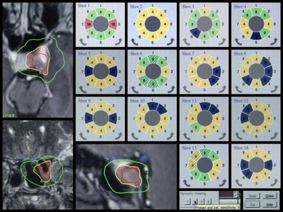
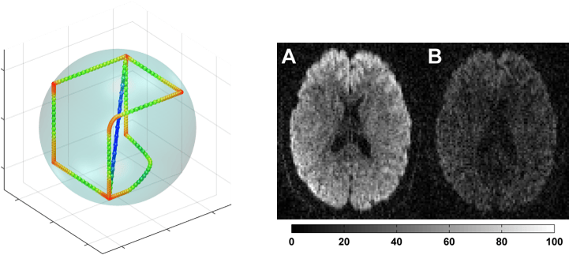

Our work in medical technology spans radiotherapy planning, diffusion MRI, breast cancer diagnostics, and drug discovery---each an active area where principled computational methods make a real difference.

## Radiotherapy planning

Radiotherapy planning is complex and time consuming. At [Elekta](https://www.elekta.com), we did the research groundwork for the next-generation treatment optimizer for [Leksell Gamma Knife Lightning](https://www.elekta.com/radiosurgery/leksell-gamma-knife-lightning/), a commercial radiosurgery planning system used worldwide. This included new convex surrogates for common clinical objectives, techniques for reducing problem size, AI-powered problem compression, and methods for automatically assigning weights based on historical treatment data. We also developed a method that incorporates delivery constraints directly into a neural network, ensuring predicted treatment plans are actually realizable. This work resulted in 11 granted US patents. We continue to work on radiotherapy optimization, currently through a VINNOVA-funded project with Elekta on data-driven decision support.

<small>Gamma Knife treatment planning: MRI scans with dose contours (left) and the corresponding dynamic sector configurations (right).</small>

We also developed a parallel ADMM algorithm for the LP formulation used in Gamma Knife Lightning, enabling interactive Pareto navigation of clinical trade-offs by optimizing hundreds of plans with different objective weightings---achieving speedups of up to 1500x on GPU compared to the simplex solver.

### Selected references

- **Sjölund J**, Riad S, Hennix M, and Nordström H. [_A linear programming approach to inverse planning in Gamma Knife radiosurgery._](https://doi.org/10.1002/mp.13440) Medical Physics (2019).
- Mair S, Fu A, and **Sjölund J**. [_Efficient radiation treatment planning based on voxel importance._](https://doi.org/10.1088/1361-6560/ad68bd) Physics in Medicine & Biology (2024).
- da Silva J, Hernández Escobar D, Kjellsson Lindblom T, Nordström H, and **Sjölund J**. [_A parallel algorithm for generating Pareto-optimal radiosurgery treatment plans._](https://arxiv.org/abs/2509.08602) Medical Physics (2026).

## Diffusion MRI

Diffusion MRI is a useful probe of tissue microstructure, which can be used to derive biomarkers for diagnostics and treatment. In collaboration with [Filip Szczepankiewicz](https://scholar.google.se/citations?user=ktiCQwMAAAAJ&hl=sv&oi=ao) and others, we developed the open-source library [NOW](https://github.com/jsjol/NOW) that has established itself as the de facto standard tool for gradient waveform design for tensor-valued encoding in diffusion MRI. Since its introduction in 2015, the methodology and software has been extended and refined to capture additional effects, including Maxwell compensation, motion compensation and cross-term compensation.

A recent collaboration, led by Filip Szczepankiewicz's group, introduced slice excitation with random overlap (SERO). Thick slices are excited at random, overlapping positions, so the repetition time varies within and between slices. The resulting T1 weighting allows super-resolution reconstruction across slices together with maps of diffusivity, diffusional variance and T1 relaxation.

<small>Optimized gradient waveforms (left) enable tensor-valued diffusion encoding, revealing microstructural information in the brain (right).</small>

### Selected references

- **Sjölund J**, Szczepankiewicz F, Nilsson M, Topgaard D, Westin C-F, and Knutsson H. [_Constrained optimization of gradient waveforms for generalized diffusion encoding._](https://doi.org/10.1016/j.jmr.2015.10.012) Journal of Magnetic Resonance (2015).
- Szczepankiewicz F, **Sjölund J**, Ståhlberg F, Lätt J, and Nilsson M. [_Tensor-valued diffusion encoding for diffusional variance decomposition (DIVIDE): Technical feasibility in clinical MRI systems._](https://doi.org/10.1371/journal.pone.0214238) PLoS One (2019).
- Mortensen F, Jurek J, **Sjölund J**, Vis G, Wirestam R, Molendowska M, Materka A, and Szczepankiewicz F. [_Toward super-resolution reconstruction of diffusion–relaxation MRI using slice excitation with random overlap (SERO)._](https://doi.org/10.1002/mrm.70282) Magnetic Resonance in Medicine (2026).

## Breast cancer diagnostics (AID4BC)

We participate in the [AID4BC](https://aid4bc.org/) consortium, a multimodal AI initiative focused on precision diagnostics and decision support for breast cancer. Our contribution, together with [Dave Zachariah](https://www.uu.se/en/contact-and-organisation/staff?query=N13-1398) at Uppsala University, centres on multimodal machine learning methods and causal foundations for internally and externally valid clinical decision-making. Together with the other partners---Karolinska Institutet, Lund University, Linköping University, and industry partners Sectra and Stratipath---we are building the world's largest multi-site and multi-modal breast cancer study (N > 10,000).

## Drug discovery

Together with AstraZeneca, we develop machine learning methods for drug discovery. Potency prediction is usually framed as regression on a single summary number, the half-maximal inhibitory concentration. We instead model the entire dose–response curve as the cumulative distribution function of a latent concentration variable. The model learns from the raw measurements and retains the slope, asymptotes and shape of the curve, which the summary number discards.

We also study language models as tools in the drug discovery workflow. In agentic systems that orchestrate chemistry tools, components such as the language model and the type of agent cannot simply be exchanged without re-engineering the system. For bioassay databases, where annotations are often missing or inconsistent, language models can support large-scale annotation and auditing of assay metadata, although rare classes still need targeted human review.

### Selected references

- van Weesep L, Genheden S, Engkvist O, and **Sjölund J**. [_Exploring modularity of agentic systems for drug discovery._](https://arxiv.org/abs/2506.22189) European Conference on Multi-Agent Systems (2025).
- van Weesep L, Tedoldi R, **Sjölund J**, Azizpour H, Winiwarter S, Engkvist O, Janet J P, Genheden S, and Viguera Diez J. [_Can LLMs reliably annotate bioassay metadata to improve data readiness?_](https://arxiv.org/abs/2610.01616) NeurIPS Workshop on AI Data Readiness for Scientific Discovery (2026).
- O'Nils A, Sarao Mannelli S, Engkvist O, **Sjölund J**, and Westerlund A M. [_Potency prediction via probabilistic modeling of dose–response curves._](https://doi.org/10.26434/chemrxiv.15008694/v1) ChemRxiv (2026).
